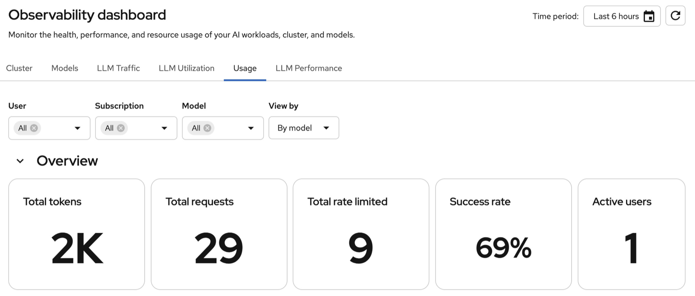
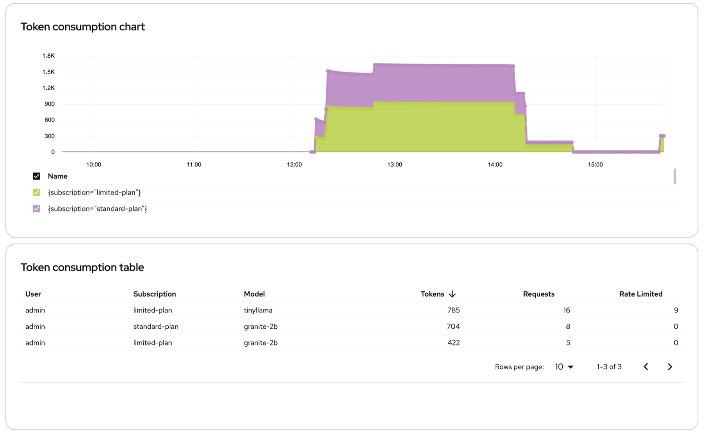
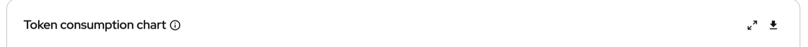

# Part 2 — Chapter 5: Observe usage and export showback

**Role:** AI ops administrator. Complete [Chapter 4](../chapter-4/README.md) first. Operators, labels, storage, and dashboards were configured in [Chapter 3's observability setup](../chapter-3/README.md#step-4-enable-the-openshift-ai-metrics-stack).

Compare token consumption by model and subscription. Mapping (cost centers come from each subscription's `tokenMetadata`): `standard-plan` → `department-a` / `CC-1001`, `limited-plan` → `department-b` / `CC-2001`. The dashboard filters on subscriptions, not OpenShift group names.

> [!NOTE]
> MaaS showback is Technology Preview. It supports internal usage attribution and capacity planning; token metrics are not billing-grade metering or external invoices. This chapter uses the metrics-based administrator dashboard. The separate Loki-based pipeline and user-scoped dashboards are outside this walkthrough.

## Step 1: Generate comparable usage

Use the two keys from [creating demonstration API keys](../chapter-3/README.md#step-7-create-demonstration-api-keys). Create three usage series: department-a on Granite, and department-b on Granite and TinyLlama. First seed each series so monitoring can establish a counter baseline:

```bash
: "${ROUTE_HOST:?Set the gateway hostname}"
: "${MAAS_API_KEY_A:?Set the department-a key}"
: "${MAAS_API_KEY_B:?Set the department-b key}"
```

```bash
send_request() {
  curl -sS --max-time 60 -o /dev/null -w "$1 HTTP:%{http_code}\n" \
    https://$ROUTE_HOST/ai-models/$1/v1/chat/completions \
    -H "Authorization: Bearer $2" \
    -H 'Content-Type: application/json' \
    -d "$(jq -n --arg model "$1" \
      '{model:$model,messages:[{role:"user",content:"Explain Kubernetes in one sentence."}],max_tokens:40}')"
}

send_request granite-2b "$MAAS_API_KEY_A"
send_request granite-2b "$MAAS_API_KEY_B"
send_request tinyllama "$MAAS_API_KEY_B"
```

Expect `HTTP:200` for all three. On OpenShift AI 3.5.1 and earlier, add `stream:true` to the request body ([known issue](../KNOWN-ISSUES.md#non-streaming-requests-return-an-empty-body)).

Wait for the collector and Prometheus to scrape, then generate increments:

```bash
sleep 45
for i in $(seq 1 3); do
  send_request granite-2b "$MAAS_API_KEY_A"
  send_request granite-2b "$MAAS_API_KEY_B"
  send_request tinyllama "$MAAS_API_KEY_B"
done
```

Allow another 1–2 minutes for collection. If TinyLlama returns `429` because an earlier Chapter 6 run left the quota lowered, [restore the 1,000 tokens/minute limit](../chapter-6/README.md#step-4-restore-the-demo-quota), then wait for the one-minute window to reset.

## Step 2: Explore the embedded dashboard

1. Log in to the **OpenShift AI dashboard** as an administrator.
2. Open **Observe & monitor → Dashboard → Usage**. Refresh the browser if the tab was created after you opened the page.
3. Choose a time period that includes your new traffic, such as **Last 30 minutes**, and click **Refresh**.
4. Review **Total tokens**, **Total requests**, **Total rate limited**, **Success rate**, and **Active users**.



*Example captured on OpenShift AI 3.5.1 using **Last 6 hours** to include the full demo. The screenshots include the rate-limit test from Chapter 6; before that test, zero rate-limit rejections are expected. Your totals will differ.*

5. In **Subscription**, select `standard-plan`. In **Model**, select `granite-2b`.
6. Switch Subscription to `limited-plan` and compare Granite and TinyLlama.
7. Set **View by** to **By subscription** to compare departments, then **By model** to compare model consumption. Reset filters to **All** when making an overall comparison.
8. Scroll down to the **Token consumption table** to inspect the user/subscription/model rows.

Expected nonzero combinations:

| Subscription | Department | Model |
|---|---|---|
| `standard-plan` | department-a | `granite-2b` |
| `limited-plan` | department-b | `granite-2b` |
| `limited-plan` | department-b | `tinyllama` |



*With **View by → By subscription** and filters set to **All**, the chart compares the two plans and the table shows all three subscription/model combinations. The TinyLlama row also shows the Chapter 6 rejections.*

One administrator owns both keys, so **Active users can be 1** even though two departments have traffic. Counts are derived from sampled counter increases and can differ from the exact number of requests you sent. Initial counter values, scrape timing, and restarts affect the result.

## Step 3: Export and verify usage

Set **View by → By subscription** for department attribution, or **By model** for model comparison. Hover over or click the **Token consumption chart** panel, then click **Export time series data as CSV** in its top-right toolbar.



*Use the download arrow at the far right of the chart header; the adjacent diagonal arrows change the panel view mode.*

The browser downloads `tokenConsumptionChart_data.csv`. It contains a `DateTime` column followed by series columns such as `{subscription=_limited-plan_}` or `{model=_tinyllama_}`. This exports the chart's sampled time series, not the user table. The selected filters determine which series appear. Check the headers and nonzero values before using the file for showback.

**Administrator troubleshooting:** for an independent pipeline check, query the same Thanos endpoint used by the Usage dashboard:

```bash
oc exec -n openshift-user-workload-monitoring sts/prometheus-user-workload -c prometheus -- \
  curl -s 'http://thanos-querier-data-science-thanos-querier.redhat-ods-monitoring.svc.cluster.local:10902/api/v1/query?query=authorized_hits_total' \
  | jq '.data.result[] | {user: .metric.user, subscription: .metric.subscription, model: .metric.model, tokens: .value[1]}'
```

Expect entries with your username, the two subscription names, and the relevant models. This query shows cumulative counters; the dashboard calculates increases over the selected time range. Raw user-workload Prometheus exposes `authorized_hits`, whereas the AI OpenTelemetry pipeline exposes `authorized_hits_total`. Querying the wrong metric name or monitoring instance can make a healthy pipeline look empty.

If the dashboard is still empty, use the [observability checks](../chapter-3/README.md#step-4-enable-the-openshift-ai-metrics-stack) to verify the user label, `limitador-metrics` ServiceMonitor, collector readiness, and time range. Send a second round after the first scrape: `increase()` needs multiple samples. The default dashboard's token chart uses a fixed two-hour increase window in 3.5; use the overview/table and selected time range when checking totals.

Proceed to [Chapter 6: Operate token budgets](../chapter-6/README.md) to demonstrate token-budget enforcement and inspect rejection counts and model performance in the built-in OpenShift AI dashboards.

References: [MaaS administration and showback](https://docs.redhat.com/en/documentation/red_hat_openshift_ai_self-managed/3.5/html/govern_llm_access_with_models-as-a-service/deploy-and-manage-models-as-a-service), [OpenShift AI observability](https://docs.redhat.com/en/documentation/red_hat_openshift_ai_self-managed/3.5/html/managing_openshift_ai/managing-observability_managing-rhoai).
