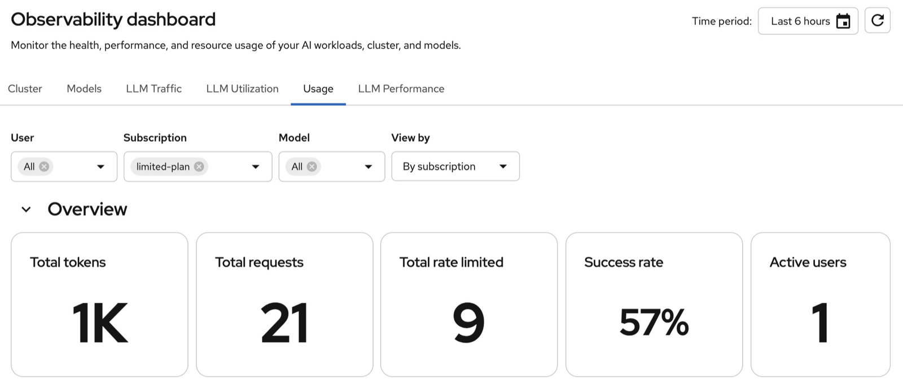

# Chapter 6: Observability & Rate Limiting

Chapter 5 covered token consumption and showback in the embedded OpenShift AI Usage dashboard. Now demonstrate token-budget enforcement and inspect the results in the same UI. In this chapter you'll:

1. Verify telemetry for token tracking
2. Tighten token limits and demonstrate HTTP `429` responses
3. Compare consumption and rate-limit rejections in OpenShift AI
4. Explore the built-in model performance dashboards

## Before You Begin

Every curl example in this chapter uses a `department-b` API key on the `limited-plan` subscription — that's the plan this chapter tightens and rate-limits. Confirm your user is still in `department-b` from Chapter 4, Step 5:

```bash
oc get groups | grep department
```

Expected output — your username under `department-b`, not `department-a`:

```
department-a
department-b   admin
```

If your username isn't under `department-b`, move it there:

```bash
oc adm groups remove-users department-a $(oc whoami)
oc adm groups add-users department-b $(oc whoami)
```

Reuse the department-b key retained from Chapter 4:

```bash
export ROUTE_HOST=$(oc get route openshift-ai-inference -n openshift-ingress -o jsonpath='{.spec.host}')
: "${MAAS_API_KEY_B:?Set the department-b key saved in Chapter 4}"
export MAAS_API_KEY=$MAAS_API_KEY_B
```

If that key was lost or revoked, or you just changed group membership, create a replacement while in department-b instead:

```bash
export ROUTE_HOST=$(oc get route openshift-ai-inference -n openshift-ingress -o jsonpath='{.spec.host}')
MAAS_API_KEY=$(curl -sS -k --fail-with-body --max-time 60 -X POST https://$ROUTE_HOST/maas-api/v1/api-keys \
  -H "Authorization: Bearer $(oc whoami -t)" \
  -H "Content-Type: application/json" \
  -d '{"name":"department-b-chapter6","subscription":"limited-plan"}' \
  | jq -er '.key // error(tostring) | select(type == "string" and startswith("sk-oai-"))') && export MAAS_API_KEY
: "${MAAS_API_KEY:?API key creation failed; check the API response and group membership}"
export MAAS_API_KEY_B=$MAAS_API_KEY
```

> **Getting `400 {"code":"invalid_subscription",...}`?** The requested subscription must be accessible to the identity seen by the MaaS API — `standard-plan` is for `department-a`, `limited-plan` for `department-b`. After changing groups, cached authentication can temporarily retain the previous membership. Follow the [Chapter 4 API visibility check](../chapter-4/README.md#move-your-user-to-department-b) and wait until the API reports `limited-plan`, then retry key creation.

Keep `$MAAS_API_KEY` and `$ROUTE_HOST` exported for the rest of this chapter — later steps reference "your department-b key" assuming it's already set.

## Step 1: Verify Telemetry

Chapter 1 enabled Kuadrant observability and tenant telemetry on the gateway. Confirm the resources are still present before generating traffic:

```bash
oc get podmonitor kuadrant-limitador-monitor -n kuadrant-system
oc get telemetrypolicy maas-telemetry -n openshift-ingress
```

If either resource is missing, re-run the [MaaS Telemetry](../chapter-1/README.md#maas-telemetry) section from Chapter 1 and restart the gateway. Then reapply Chapter 5's `captureUser: true` configuration so the Usage dashboard continues to receive labeled traffic.

Open **OpenShift AI → Observe & monitor → Dashboard → Usage** before the test. Select **Last 30 minutes**, the `limited-plan` subscription, and **Model → All**. Refresh and note the current **Total tokens** and **Total rate limited** values so you can compare them after the burst.

## Step 2: Trigger Rate Limiting

Each `MaaSSubscription` defines a per-model **token budget** for a time window. The generated policy on this cluster counts by `auth.identity.userid`: keys for the same user, subscription, and model share a budget. Creating another key does not reset it. When the budget is exhausted the gateway returns `429 Too Many Requests` until the window resets. MaaS translates each `tokenRateLimits` entry into a Kuadrant `TokenRateLimitPolicy` on the model's HTTPRoute. `"stream": true` is required on every request (see [KNOWN-ISSUES.md](../KNOWN-ISSUES.md)).

List the policies MaaS created:

```bash
oc get tokenratelimitpolicy -A
```

Inspect the TinyLlama policy for `department-b`'s limited plan:

```bash
oc get tokenratelimitpolicy maas-trlp-tinyllama -n ai-models -o json \
  | jq -r '.spec.limits | to_entries[] | "\(.key): \(.value.rates[0].limit) tok / \(.value.rates[0].window)"'
```

Expected output — the 1,000 tok/min value from your `MaaSSubscription`:

```
models-as-a-service-limited-plan-tinyllama-tokens: 1000 tok / 1m
```

> **Do not edit these resources directly.** The MaaS controller reconciles them from your `MaaSSubscription` definitions. Manual changes will be overwritten.

### Tighten the Limit for the Demo

The default 1,000 tok/min limit is too high for a quick demo. Lower TinyLlama to **100 tokens per minute** so a single request exhausts the budget and the next request gets a 429:

```bash
oc patch maassubscription limited-plan -n models-as-a-service --type=json \
  -p='[{"op": "replace", "path": "/spec/modelRefs/1/tokenRateLimits/0/limit", "value": 100}]'
```

Verify the MaaS controller updated the underlying policy:

```bash
oc get tokenratelimitpolicy maas-trlp-tinyllama -n ai-models -o json \
  | jq -r '.spec.limits | to_entries[] | "\(.key): \(.value.rates[0].limit) tok / \(.value.rates[0].window)"'
```

Expected output:

```
models-as-a-service-limited-plan-tinyllama-tokens: 100 tok / 1m
```

Wait for the generated policy to contain the new value and be enforced:

```bash
oc wait tokenratelimitpolicy/maas-trlp-tinyllama -n ai-models \
  --for=jsonpath='{.spec.limits.*.rates[0].limit}'=100 --timeout=120s
oc wait tokenratelimitpolicy/maas-trlp-tinyllama -n ai-models \
  --for=condition=Enforced --timeout=120s
```

Allow at least 65 seconds without TinyLlama traffic before each independent rate-limit test so the previous one-minute budget expires. A routine quota update is reconciled by the controllers; a gateway restart is a troubleshooting step, not a quota reset.

### Smoke Test with curl

Confirm rate limiting works from your workstation. Use your `department-b` limited-plan key — a `department-a` key has no access to TinyLlama. Send one request to consume tokens, then a second request that should be rejected:

```bash
curl -s -k -w '\nHTTP:%{http_code}\n' \
  -X POST https://$ROUTE_HOST/ai-models/tinyllama/v1/chat/completions \
  -H "Authorization: Bearer $MAAS_API_KEY" \
  -H "Content-Type: application/json" \
  -d '{
    "model": "tinyllama",
    "messages": [{"role": "user", "content": "Write a short paragraph about the history of bread."}],
    "max_tokens": 200,
    "stream": true
  }' | tail -3

curl -s -k -w '\nHTTP:%{http_code}\n' \
  -X POST https://$ROUTE_HOST/ai-models/tinyllama/v1/chat/completions \
  -H "Authorization: Bearer $MAAS_API_KEY" \
  -H "Content-Type: application/json" \
  -d '{
    "model": "tinyllama",
    "messages": [{"role": "user", "content": "Write a short paragraph about the history of bread."}],
    "max_tokens": 200,
    "stream": true
  }' | tail -1
```

Expected output — first request succeeds, second is rejected:

```
HTTP:200
HTTP:429
```

**Before measuring rejections in Usage:** treat the smoke test above as a warm-up. The first `429` creates the rejection counter, and its first collected value becomes the dashboard's baseline. Allow 1–2 minutes for collection before sending another burst. This also lets the one-minute token budget expire. Waiting and refreshing alone will not turn that first rejection into a visible increase.

Now run the Red Hat quick-test loop (sends 10 rapid requests and counts status codes):

```bash
for i in $(seq 1 10); do
  curl -s -k -o /dev/null -w "%{http_code}\n" \
    -X POST https://$ROUTE_HOST/ai-models/tinyllama/v1/chat/completions \
    -H "Authorization: Bearer $MAAS_API_KEY" \
    -H "Content-Type: application/json" \
    -d '{"model":"tinyllama","messages":[{"role":"user","content":"test"}],"max_tokens":50,"stream":true}'
done | sort | uniq -c
```

Expected output — a mix of `200` and `429`:

```
   1 200
   9 429
```

Counts are illustrative and depend on generated tokens and the remaining budget. If you run this immediately after the smoke test, all ten requests may return `429`; let the window expire before repeating. If a short completion consumes fewer than 100 tokens, more than one request may succeed.

> **What is being limited?** Actual tokens consumed (from `usage.total_tokens` in each response), not request count. Enforcement happens at the gateway — rejected requests never reach the model server.

### Troubleshooting

If every request returns `200` and you never see a `429`:

1. **Confirm the API key belongs to `limited-plan`.** Keys capture group membership at creation time. If you created the key while still in `department-a`, revoke it and create a new one on the `limited-plan` subscription (Chapter 4, Step 5).

2. **Confirm the limit patch applied:**

   ```bash
   oc get tokenratelimitpolicy maas-trlp-tinyllama -n ai-models -o json \
     | jq '.spec.limits[].rates[0].limit'
   ```

   Should print `100`.

3. **Confirm telemetry is enabled and the gateway was restarted** (Chapter 1). Rate limiting depends on the Kuadrant Wasm filters on `maas-default-gateway`:

   ```bash
   oc get telemetrypolicy maas-telemetry -n openshift-ingress
   oc get tokenratelimitpolicy maas-trlp-tinyllama -n ai-models \
     -o jsonpath='{.status.conditions[?(@.type=="Enforced")].status}{"\n"}'
   ```

4. **Check Limitador is receiving traffic** for the TinyLlama route:

   ```bash
   oc port-forward -n kuadrant-system svc/limitador-limitador 8080:8080 &
   LIMITADOR_FORWARD_PID=$!
   sleep 2
   curl -s http://localhost:8080/metrics | grep tinyllama
   kill "$LIMITADOR_FORWARD_PID"
   ```

   After the smoke test you should see metrics with `limitador_namespace="ai-models/tinyllama-kserve-route"`. If only `granite-2b` appears, restart the gateway and retry.

5. **Check Authorino logs** for subscription metadata errors:

   ```bash
   oc logs -n kuadrant-system deploy/authorino --tail=50 | grep selected_subscription
   ```

   Token rate limits only apply when `auth.identity.selected_subscription_key` matches your plan. If Authorino cannot resolve the subscription, limits are silently skipped.

   > **Note:** Authorino also logs `failed to evaluate CEL expression ... no such key: selected_subscription` (without `_key`) on essentially every request, for every model, even when everything works. That's a separate, benign metric-labeling expression and not evidence of a problem — only investigate further if you see errors that reference `selected_subscription_key` or `subscription-info` itself.

6. **Check for a Kuadrant Wasm shim task failure** — this is the most likely cause if steps 1–5 all check out and you still only see `200`s:

   ```bash
   GW_POD=$(oc get pods -n openshift-ingress -l 'gateway.networking.k8s.io/gateway-name=maas-default-gateway' -o jsonpath='{.items[0].metadata.name}')
   oc logs $GW_POD -n openshift-ingress --since=2m | grep "Task failed"
   ```

   If every `/v1/chat/completions` request is immediately preceded by a line like `kuadrant_wasm_shim: Task failed: Some("N")`, the gateway's rate-limiting Wasm filter is failing its async callout to Limitador on every request — token usage is never recorded, so the budget never depletes and `429` never fires. Confirmed reproducible on a completely fresh `maas-default-gateway` pod (i.e. not stale state) affecting **both** Granite and TinyLlama routes, on rhcl-operator v1.4.2. Restarting Limitador and the gateway does **not** clear it.

   On the previously tested 3.4.3 / RHCL 1.4.2 environment, this indicated a platform bug in Kuadrant's Wasm rate-limiting shim, not something fixable via `MaaSSubscription`/`TokenRateLimitPolicy` changes. If you hit this, the token-budget and 429 behavior in the rest of this chapter cannot be demonstrated until an upstream fix or a newer `rhcl-operator` build is available — check `oc get subscription rhcl-operator -n kuadrant-system -o jsonpath='{.status.installedCSV}'` against the latest in your catalog. The built-in consumption and model performance dashboards can still be explored, but successful enforcement must be demonstrated with actual `429` responses; a dashboard alone does not prove enforcement.

## Step 3: Show Consumption and Rejections in OpenShift AI

Return to the Usage view opened in Step 1. Keep the `limited-plan` subscription selected and leave **Model → All** when checking gateway rejection counts: the platform's rate-limited counter does not carry the same model label as its token counter.

After the test:

1. Allow 1–2 minutes for collection, then click **Refresh**.
2. Show **Total rate limited**, then inspect your user/subscription usage in the token consumption table.
3. Compare **Total tokens** and the token consumption chart/table with the pre-test values. Successful requests consume tokens; rejected requests do not run inference and consume no model tokens.
4. Switch the Model filter to TinyLlama to inspect its token consumption, then reset it to **All** for the rejection comparison.



*Example after the 100-token/minute test: `limited-plan` has **9** rate-limit rejections. This six-hour view includes preparation traffic, so its **21** total requests are not just the ten-request burst. The quota was restored to 1,000 tokens/minute after the test.*

### HTTP 429 Works but Total Rate Limited Is Zero

The dashboard counts **increases between collected counter samples**, rather than displaying the cumulative rejection counter. If the first rejection creates a series at `1` and every subsequent scrape still sees `1`, `increase()` is `0`. This can also hide an entire first burst if all its rejections occur before the first scrape. Waiting longer or widening the time range cannot recover the missing initial increase.

1. Select **User → All**, **Subscription → limited-plan**, **Model → All**, and **Last 30 minutes**.
2. After the first rejected request, allow 1–2 minutes for collection.
3. Repeat the ten-request burst from Step 2 and confirm it includes `429` responses.
4. Allow another 1–2 minutes, then click **Refresh**. The counter now has a baseline and a higher sample, so Usage can show the increase.

For example, collected values of `1 → 10` show approximately nine new rejections; the first rejection remains part of the baseline. Exact dashboard counts can differ because counter increases are sampled and extrapolated. Keep the baseline and repeat burst inside the selected reporting period.

**The acceptance criteria are both:** curl demonstrates `HTTP:429` once the token budget is exhausted, and the built-in Usage dashboard shows nonzero token consumption and rate-limit rejections. Chapter 5's three subscription/model combinations should remain visible when the filters are cleared.

### Optional: Check the Metrics Pipeline

For troubleshooting, query the AI monitoring stack used by Usage. This needs no extra dashboard, datasource, or OpenShift console plugin:

```bash
oc exec -n openshift-user-workload-monitoring sts/prometheus-user-workload -c prometheus -- \
  curl -s 'http://thanos-querier-data-science-thanos-querier.redhat-ods-monitoring.svc.cluster.local:10902/api/v1/query?query=authorized_hits_total' \
  | jq '.data.result[] | {user: .metric.user, subscription: .metric.subscription, model: .metric.model, tokens: .value[1]}'

oc exec -n openshift-user-workload-monitoring sts/prometheus-user-workload -c prometheus -- \
  curl -s 'http://thanos-querier-data-science-thanos-querier.redhat-ods-monitoring.svc.cluster.local:10902/api/v1/query?query=limited_calls_total' \
  | jq '.data.result[] | {user: .metric.user, subscription: .metric.subscription, route: .metric.limitador_namespace, rejections: .value[1]}'
```

These queries show current cumulative counters; Usage shows increases for its reporting period. The AI pipeline exposes `authorized_hits_total` and `limited_calls_total`; raw user-workload Prometheus uses `authorized_hits` and `limited_calls`. Chapter 5 explains that distinction and the shipped chart's fixed two-hour window.

To distinguish a baseline-only counter from a collection failure, compare the cumulative rejection count above with its increase:

```bash
oc exec -n openshift-user-workload-monitoring sts/prometheus-user-workload -c prometheus -- \
  curl -sG 'http://thanos-querier-data-science-thanos-querier.redhat-ods-monitoring.svc.cluster.local:10902/api/v1/query' \
  --data-urlencode 'query=sum(increase(limited_calls_total{user!="",subscription="limited-plan"}[30m])) or vector(0)' \
  | jq '.data.result'
```

A positive cumulative count with zero increase matches the baseline case described above. No cumulative series after collection calls for checking the `limitador-metrics` ServiceMonitor and AI collector from Chapter 5. If the increase is positive but Usage stays at zero, check the dashboard filters and confirm `authorized_hits_total` has matching `user`, `subscription`, and `limitador_namespace` labels for successful traffic in the same period: the shipped dashboard joins rejection counts to those token-usage series to apply its Model filter.

## Step 4: Explore Built-in Model Observability

Stay in **OpenShift AI → Observe & monitor → Dashboard**. These views use the metrics stack installed in Chapter 5:

| View | What to demonstrate |
|---|---|
| **Usage** | Token consumption by subscription/model, request counts, and rate-limit rejections |
| **Models** | Model deployments, token throughput, request success rate, latency, and time to first token |
| **LLM Traffic** | Request throughput, error rate, and token throughput for llm-d |
| **LLM Performance** | Latency, time to first token, inter-token latency, and KV cache metrics |
| **LLM Utilization** | GPU utilization, running requests, and waiting requests |

Choose the `ai-models` project/namespace and relevant model where those filters are available. Generate a few successful requests after restoring the quota below, allow a scrape interval, and refresh. Rate-limited requests stop at the gateway, so model performance panels describe the requests that actually reached vLLM. A brief demo burst can leave rate charts sparse; choose a time range covering the traffic. A GPU panel also needs the GPU metrics exporter to be collected; an empty GPU panel does not invalidate the token-consumption or rate-limit demo.

OpenShift AI 3.5 creates model PodMonitors automatically. If model metrics are absent, inspect the existing monitors and model pod labels before adding anything:

```bash
oc get podmonitor -n ai-models --show-labels
oc get pods -n ai-models --show-labels
oc get pods -n redhat-ods-monitoring
```

Do not add a second scrape of the same model to fix an empty chart; diagnose the existing monitor, collector, filters, and traffic first. For details, see [OpenShift AI observability](https://docs.redhat.com/en/documentation/red_hat_openshift_ai_self-managed/3.5/html/managing_openshift_ai/managing-observability_managing-rhoai).

## Restore the Demo Quota

Return TinyLlama to the Chapter 4 limit after testing:

```bash
oc patch maassubscription limited-plan -n models-as-a-service --type=json \
  -p='[{"op":"replace","path":"/spec/modelRefs/1/tokenRateLimits/0/limit","value":1000}]'
```

Wait for the generated policy to show `1000`:

```bash
oc wait tokenratelimitpolicy/maas-trlp-tinyllama -n ai-models \
  --for=jsonpath='{.spec.limits.*.rates[0].limit}'=1000 --timeout=120s
```

Wait for the one-minute budget window to reset before running more traffic.

## Revoke the Test API Keys

After finishing your demos, open **Gen AI studio → API keys** in OpenShift AI and revoke `department-a-test`, `department-b-test`, and any additional keys created during the walkthrough. Revoking keys preserves historical usage metrics.
